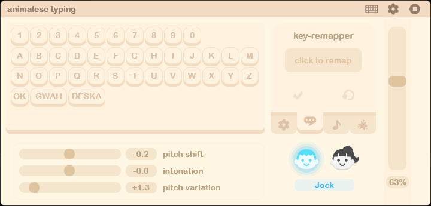
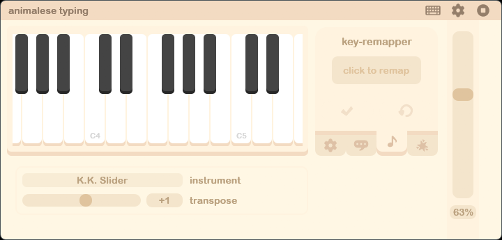
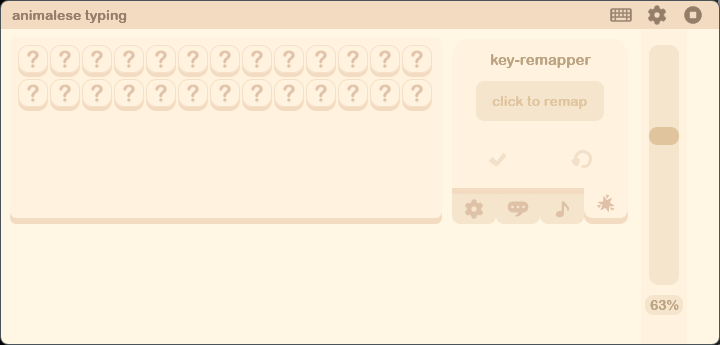
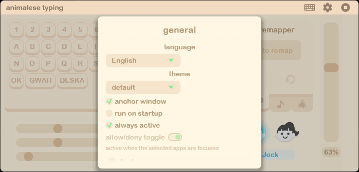
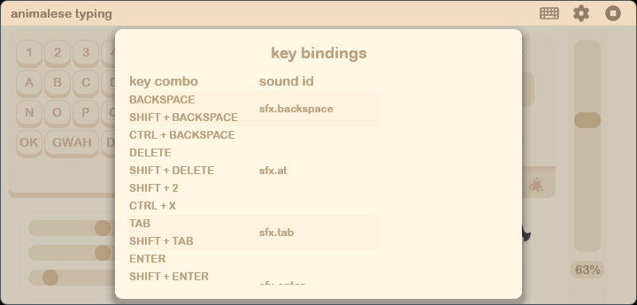

# RUST Animalese Typing Desktop

**Animal Crossing voices and sounds every time you type**, now as a tiny native Windows app
written in Rust.

This is a Rust port of [Animalese Typing Desktop](https://github.com/joshxviii/animalese-typing-desktop)
by [joshxviii](https://github.com/joshxviii). It has the same sounds, voices, layouts and look,
but it uses a fraction of the memory and disk space. It's **free and open source** (MIT): no
ads, no accounts, no telemetry.



## Why the Rust version?

The original is an Electron app, which means a full Chromium browser runs in the background
just to play short sound clips. This port does the same job natively.

Measured on the same Windows 11 PC, idle in the tray:

| | Original (Electron 0.0.6) | Rust port |
|---|---|---|
| Processes | 5 Chromium processes + key listener | **1** |
| Memory (private) | ~260 MB | **~10 MB** |
| Memory (working set) | ~515 MB | **~20 MB** |
| Download / install size | ~210 MB exe + 22 MB app archive | **~11 MB single exe** (sounds built in) |
| CPU while typing nonstop (~140 wpm) | – | **~0.1% of one core** (mixer) |
| CPU while idle | ~0% | **~0%** (audio stream pauses after 3 s of silence) |

Other advantages:

- **One portable exe.** No installer, no runtime, and the sounds are embedded.
- **Lower latency.** The keyboard hook and the audio mixer live in the same process, so a key
  goes straight to sound. The original passed it from a listener exe as JSON text, through the
  main process and the renderer, to Web Audio.
- **No polling.** The "only in these apps" filter reacts to focus changes instead of checking
  the active window every 500 ms.
- **Follows your audio device.** Plug in headphones or change the default output and it moves
  over automatically.
- **The editor only exists while it's open.** It runs as a separate process when you open it
  and frees all its memory when you close it. The tray part never loads a GUI toolkit.
- **Keeps your settings.** On first run it imports your existing Animalese Typing settings,
  including voice, volume, instrument and key remaps.

## Features

Everything from the original desktop app:

- 8 voices (Sweet, Peppy, Big sister, Snooty, Jock, Lazy, Smug, Cranky), English and Korean
- Pitch shift, intonation and pitch variation. Caps Lock or Shift makes the voice shout
- Number keys play notes on 9 instruments (Girl, Boy, Cranky, K.K. Slider, Organ, Guitar,
  E. Piano, Synth, Whistle), with transpose
- Sound effects for punctuation, Enter, Backspace, arrows and more
- Audio modes: default, voice only, sfx only, randomized (disguise typing)
- Sound board and piano you can click
- Key remapper: give any key or key combo any sound, or make it the disable hotkey
- Key bindings overview
- Per-app allow/deny list, run on startup, repeat sound while held
- 4 themes (default, midnight, pink, forest) and 7 UI languages
- Tray icon with disable / editor / startup / quit

| Piano | Sound effects |
|---|---|
|  |  |

| Settings | Key bindings |
|---|---|
|  |  |

## Download

Grab `animalese-rs.exe` from the [Releases](https://github.com/abbysimple/RUST-animalese-typing-desktop/releases)
page, put it in any folder, and run it. It appears in the tray:

- **Left-click** the tray icon to open the editor.
- **Right-click** for Disable / Editor / Run on startup / Quit.
- Launching the exe again also opens the editor.

Windows only (10/11, x64). Windows SmartScreen may warn about an unsigned app the first time;
choose *More info → Run anyway*.

## Build from source

Needs a recent stable [Rust](https://rustup.rs) toolchain.

```
cargo build --release
```

The exe is at `target\release\animalese-rs.exe`. Copy it somewhere else before running it day
to day, so rebuilding doesn't fight the running exe and "Run on startup" points at a stable
path.

## How it works

| File | What it does |
|---|---|
| `src/daemon.rs` | Low-level keyboard hook, foreground-app tracking (`SetWinEventHook`), tray icon, one Win32 message loop |
| `src/player.rs` | Sound selection, ported from the original `audio-manager.cjs` (modes, voice profile, shouting, notes, hold/release) |
| `src/audio.rs` | cpal output + a small mixer: variable-rate playback with interpolation, intonation ramp, fades, idle pause, device switching |
| `src/editor/` | The egui editor (`--settings`): board, piano, remapper, editors, overlays, themes, translations, SVG icons via resvg |
| `src/config.rs` | Settings in `%APPDATA%\animalese-rs\config.json`, same format as the original |

Dev helpers:

- `animalese-rs.exe --render out.wav "Hello!"` types text into a WAV using your settings.
- `animalese-rs.exe --bench report.txt` measures mixer CPU for about 6 minutes of fast typing.
- `ANIMALESE_UI=special|piano|sfx|settings|bindings` opens the editor on that view.
- Errors and panics go to `%APPDATA%\animalese-rs\log.txt`.

The editor uses Arial Rounded MT Bold from `C:\Windows\Fonts` when it's installed, as the
original does, and otherwise falls back to a built-in font. The font isn't included here because
it isn't freely redistributable.

## Credits

- Original app, sounds, layouts, icons and translations:
  [joshxviii/animalese-typing-desktop](https://github.com/joshxviii/animalese-typing-desktop) (MIT).
  Please star the original!
- Animal Crossing is a trademark of Nintendo. This is an unofficial fan project with no
  affiliation.

## License

MIT. See [LICENSE](LICENSE).
